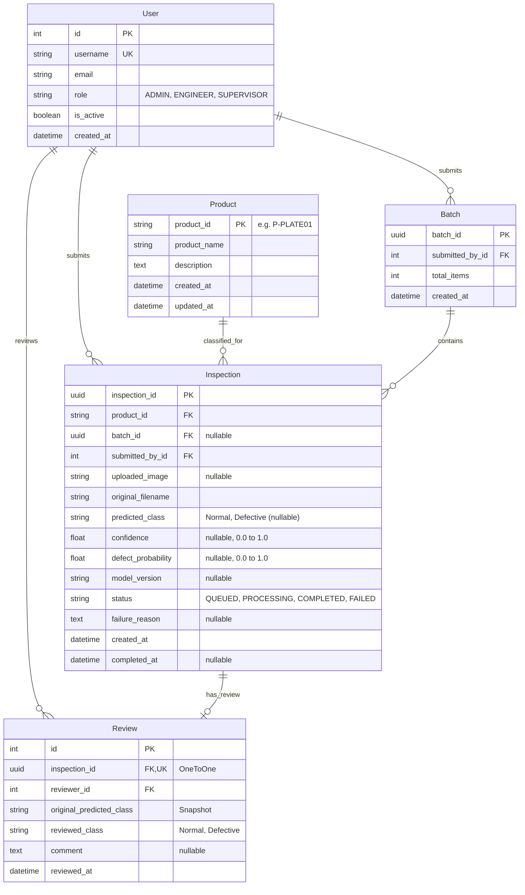

# DATABASE DESIGN
## Round 2 – AI Visual Quality Inspection System

### Table Specifications & Constraints

#### 1. `accounts_user`
- Managed by Round 1's `accounts.User` extending `AbstractUser`.
- `role`: CharField choices `ADMIN`, `ENGINEER`, `SUPERVISOR`.

#### 2. `products_product`
- `product_id`: `CharField(max_length=64, primary_key=True, db_index=True)`.
- `product_name`: `CharField(max_length=255)`.
- `description`: `TextField(blank=True)`.
- `created_at`: `DateTimeField(auto_now_add=True)`.
- `updated_at`: `DateTimeField(auto_now=True)`.

#### 3. `inspections_batch`
- `batch_id`: `UUIDField(primary_key=True, default=uuid.uuid4, editable=False)`.
- `submitted_by`: `ForeignKey(User, on_delete=models.CASCADE, related_name='batches')`.
- `total_items`: `PositiveIntegerField(default=0)`.
- `created_at`: `DateTimeField(auto_now_add=True, db_index=True)`.

#### 4. `inspections_inspection`
- `inspection_id`: `UUIDField(primary_key=True, default=uuid.uuid4, editable=False)`.
- `product`: `ForeignKey(Product, on_delete=models.PROTECT, related_name='inspections')`.
- `batch`: `ForeignKey(Batch, on_delete=models.SET_NULL, null=True, blank=True, related_name='inspections')`.
- `submitted_by`: `ForeignKey(User, on_delete=models.CASCADE, related_name='inspections')`.
- `uploaded_image`: `ImageField(upload_to='inspections/%Y/%m/%d/', null=True, blank=True)`.
- `original_filename`: `CharField(max_length=255)`.
- `predicted_class`: `CharField(max_length=32, null=True, blank=True, choices=[('Normal', 'Normal'), ('Defective', 'Defective')])`.
- `confidence`: `FloatField(null=True, blank=True)`.
- `defect_probability`: `FloatField(null=True, blank=True)`.
- `model_version`: `CharField(max_length=64, null=True, blank=True)`.
- `status`: `CharField(max_length=32, choices=[('QUEUED', 'Queued'), ('PROCESSING', 'Processing'), ('COMPLETED', 'Completed'), ('FAILED', 'Failed')], default='QUEUED', db_index=True)`.
- `failure_reason`: `TextField(null=True, blank=True)`.
- `created_at`: `DateTimeField(auto_now_add=True, db_index=True)`.
- `completed_at`: `DateTimeField(null=True, blank=True)`.
- **Database Constraints & Indexes**:
  - `CheckConstraint(check=Q(confidence__gte=0.0, confidence__lte=1.0) | Q(confidence__isnull=True), name='check_valid_confidence')`
  - `CheckConstraint(check=Q(defect_probability__gte=0.0, defect_probability__lte=1.0) | Q(defect_probability__isnull=True), name='check_valid_defect_prob')`
  - Index on `(submitted_by, created_at)` for engineer history lookups.
  - Index on `(status, created_at)` for queue and supervisor filters.

#### 5. `reviews_review`
- `inspection`: `OneToOneField(Inspection, on_delete=models.CASCADE, related_name='review')`.
- `reviewer`: `ForeignKey(User, on_delete=models.PROTECT, related_name='reviews')`.
- `original_predicted_class`: `CharField(max_length=32)`.
- `reviewed_class`: `CharField(max_length=32, choices=[('Normal', 'Normal'), ('Defective', 'Defective')])`.
- `comment`: `TextField(blank=True, default='')`.
- `reviewed_at`: `DateTimeField(auto_now_add=True)`.

