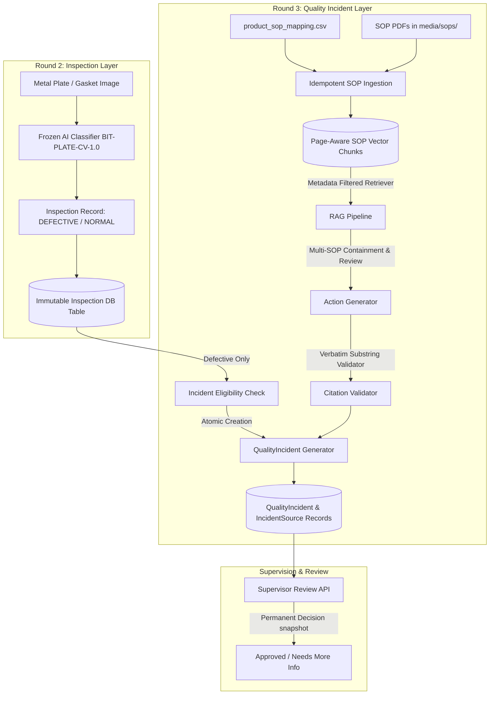

# Quality Incident & Action Assistant (Round 3)
## Enterprise Quality Management & SOP-Grounded Incident Automation

A unified manufacturing intelligence platform integrating **Round 1 (Equipment Manual RAG)**, **Round 2 (Visual Inspection & Edge Defect Detection)**, and **Round 3 (Quality Incident & Action Assistant)**.

Built on Python 3.12, Django 5.2, Django REST Framework, PostgreSQL / SQLite, Celery, Redis, PyMuPDF, and Bootstrap 5.

---

## 1. System Architecture



### Architectural Highlights
- **Round 1 (Manuals RAG)**: Interactive Q&A over heavy equipment operating manuals using page-level vector embeddings.
- **Round 2 (Edge Defect Detection)**: High-precision binary classifier (`BIT-PLATE-CV-1.0`) analyzing industrial metal plates (`P-PLATE01`) with human-in-the-loop review overrides.
- **Round 3 (Incident Assistant)**: Automated generation of quality incidents from defective inspections, strictly grounded in authoritative SOP documents with verbatim passage verification and missing-evidence fallbacks.

---

## 2. Prerequisites & Environment Setup

### Prerequisites
- Python 3.12+
- PostgreSQL (or local SQLite fallback)
- Redis (optional, for asynchronous Celery batch workers)

### Environment Configuration
Copy `.env.example` to `.env` or set the environment variables:
```bash
cp .env.example .env
```

Key environment variables:
```ini
DJANGO_SECRET_KEY=your-secret-key-here
DEBUG=True
ALLOWED_HOSTS=*
DATABASE_URL=sqlite:///db.sqlite3
SIMULATE_MISSING_SOP=False
```

---

## 3. Installation & Run Instructions

### Step 1: Install Dependencies
```bash
pip install -r requirements.txt
```

### Step 2: Apply Database Migrations
```bash
python manage.py migrate
```

### Step 3: Ingest Authoritative SOPs
Ingest and index all SOP documents according to `product_sop_mapping.csv`:
```bash
python manage.py ingest_quality_sops
```

### Step 4: Seed Demo Fixtures & Roles
Seed the roles (Administrator, Engineer, Supervisor) and the 7 preconfigured test scenarios:
```bash
python manage.py seed_round2_roles
python manage.py seed_products
python manage.py seed_round3_demo
```

### Step 5: Start the Development Server
```bash
python manage.py runserver 0.0.0.0:8000
```
Access the application at `http://127.0.0.1:8000/`.

---

## 4. Default Demo Accounts

| Role | Username | Password | Access Rights |
| :--- | :--- | :--- | :--- |
| **Engineer** | `engineer` | `engineer123` | Upload images, run inspections, create incidents for owned inspections |
| **Supervisor** | `supervisor` | `supervisor123` | Review and approve incidents, human reviews for inspections |
| **Administrator** | `admin` | `admin123` | System management, view all inspections and incidents (read-only review) |

---

## 5. Automated Test Suite

Run the full automated test suite (including all 21 Round 3 tests):
```bash
python manage.py test tests
```

To run only the Round 3 Quality Incident test suite:
```bash
python manage.py test tests.test_round3_quality_incidents
```

---

## 6. Comprehensive 26-Step Demo Walkthrough Script

Follow these 26 steps to verify the full functionality of the Round 3 Quality Incident and Action Assistant:

### Part I: Incident Creation & Grounding (Engineer Role)
1. **Login as Engineer**: Navigate to `/login/`, log in using `engineer` / `engineer123`.
2. **View Completed Defective Inspection**: Go to the **Inspection History** page (`/visual-inspection/history/`). Locate fixture `#1` (`P-PLATE01`, Defective). Note the **Create Incident** action button and **BIT-PLATE-CV-1.0** model version badge.
3. **Click 'Create Incident'**: Click the **Create Incident** button on fixture `#1` (or visit `/incidents/create/?inspection_id=1`). Click **Generate Quality Incident**.
4. **View Incident Details**: The browser redirects to `/incidents/1/`. Observe:
   - **Section A (Header)**: Status badge, product ID, inspection link, snapshot of original prediction (`Defective`, 94.2%).
   - **Section B (Summary)**: Grounded incident summary stating containment and disposition requirements.
   - **Section C (Suggested Actions)**: Sequenced immediate actions (containment, marking, supervisor notification) with clickable citation tags.
   - **Section D (Authoritative Citations)**: Detailed citation cards showing Document ID, Revision, Page number, and the exact supporting passage.
   - **Section E (Evidence Status)**: Displays `Sufficient` with explanation.
5. **PDF In-App Viewer**: Click any citation link (e.g. `[Q-PLATE-01 Rev 1.0, p. 1]`). An in-app modal opens displaying the genuine SOP PDF at the exact page.
6. **Verify Multi-SOP Grounding**: Check that citations include both mandatory plate documents:
   - `Q-PLATE-01 Rev 1.0` (Containment Protocol)
   - `Q-PLATE-02 Rev 1.0` (Engineering Review)
7. **Verify Isolation**: Verify that `Q-GASKET-01` is **NOT** cited anywhere for plate product `P-PLATE01`.
8. **Test Idempotency**: Send a repeated `POST /api/incidents/` with `{"inspection_id": 1}`. Notice HTTP `200 OK` is returned with the exact same incident ID; no duplicates are created.
9. **Test Ineligible Inspection**: Try creating an incident for Normal inspection fixture `#2` (`POST /api/incidents/ {"inspection_id": 2}`). Verify the request is rejected with HTTP `400 Bad Request` (`Only Defective inspections are eligible`).
10. **Test Access Control (Ownership)**: Attempt to create an incident for an inspection owned by another user. Verify the API returns HTTP `404 Not Found` (preventing ID enumeration).

### Part II: Supervision & Review Workflow (Supervisor Role)
11. **Login as Supervisor**: Log out and log in as `supervisor` / `supervisor123`.
12. **Navigate to Supervisor Incidents**: Click **Supervisor Review** in the sidebar (`/supervisor/incidents/`). Inspect the queue of incidents needing review.
13. **Submit Incident Review**: Open Incident `#1`. Under **Section F (Supervisor Review)**, select `Approved for follow-up`, enter review notes (e.g., `"Containment verified on Line 1. Proceed with metallographic analysis."`), and submit.
14. **Verify Permanence**: Observe that the review section is now locked. Attempting a second review via `POST /api/incidents/1/review/` returns HTTP `409 Conflict`.
15. **Verify Round 2 Data Immutability**: Inspect the underlying inspection record `#1`. Confirm `predicted_class` remains strictly `Defective` and was never overwritten by the incident review.
16. **Verify Review Display for Engineer**: Log out and log back in as `engineer`. Open Incident `#1`. Confirm Section F displays `Approved for follow-up`, reviewed by `supervisor`, with timestamp and comment visible.
17. **Verify Administrator Access**: Log in as `admin`. Open `/incidents/1/`. Observe that incidents are viewable, but the review form indicates review privileges require the Supervisor role.

### Part III: Anti-Hallucination Fallback & Corner Cases
18. **Simulate Missing SOP / Fallback**: Create an incident for fixture `#7` (or set `SIMULATE_MISSING_SOP=True`). Observe:
    - Evidence status is set to `Insufficient`.
    - Suggested actions are empty `[]`.
    - Summary provides a factual fallback: `"Defect detected for P-PLATE01. Authority documents are missing or incomplete. Escalate to Quality Engineering immediately."`
19. **Test Review Restriction on Insufficient Evidence**: As supervisor, attempt to approve the incident with `Insufficient` evidence. The API rejects approval (`400 Bad Request`). Only `Needs more information` is accepted.
20. **Inspect All 7 Seed Fixtures**: Open the Incidents list (`/incidents/`) and verify that all test scenarios (Plates, Gaskets, Approved, Pending, Insufficient) are populated and viewable.

### Part IV: System Health & Regression Verification
21. **Run Full Test Suite**: Execute `python manage.py test tests`. Confirm all unit and integration tests pass with 0 errors and 0 failures.
22. **Verify Round 1 RAG**: Navigate to `/manuals/qa/`. Ask a question about operating machinery. Confirm answers and manual citations remain functional.
23. **Verify Round 2 Visual Inspection**: Navigate to `/visual-inspection/upload/`. Upload a plate image. Confirm model inference, confidence scoring, and review override workflows remain functional.
24. **Verify RBAC Enforcements**: Confirm that Engineers cannot review incidents (`403 Forbidden`), Supervisors cannot create incidents for inspections they do not own, and anonymous users are redirected to login (`401 Unauthorized`).
25. **Verify SOP PDF Serving**: Request `GET /api/sop/Q-PLATE-01/Rev1.0/pdf/`. Confirm HTTP `200 OK` with `Content-Type: application/pdf` and inline disposition.
26. **Verify Audit Trail**: Confirm timestamps (`created_at`, `updated_at`, `reviewed_at`) and foreign keys (`creator`, `reviewer`) are accurately recorded on all models.
