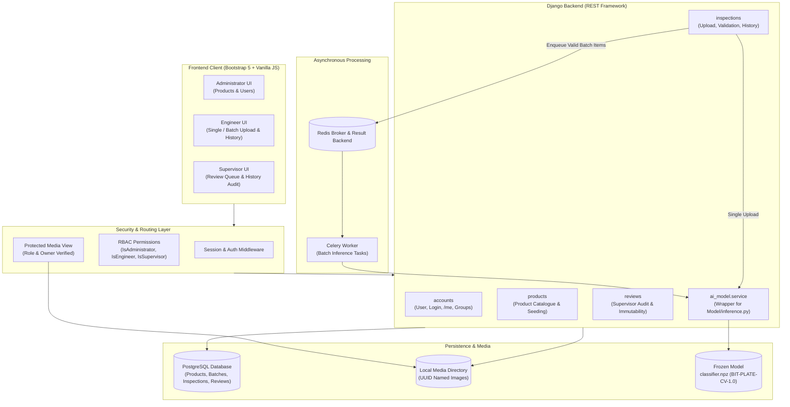

# SYSTEM ARCHITECTURE
## Round 2 – AI Visual Quality Inspection System

### Key Subsystems
1. **Frontend**: Bootstrap 5 responsive layout with unified industrial theme, role-tailored navigation bars, stat cards, asynchronous polling with live status badges.
2. **REST API**: Session and Token-compatible DRF endpoints strictly validating payload schemas and user privileges.
3. **Queueing Subsystem**: Celery dispatch via `transaction.on_commit()` ensuring zero orphaned tasks if a database rollback occurs.
4. **AI Inference Service**: Isolated Python wrapper executing standard feature extraction and logistic regression with CPU thread safety.
5. **Database**: PostgreSQL maintaining strict relational integrity, indexed foreign keys, and atomic review transactions.

